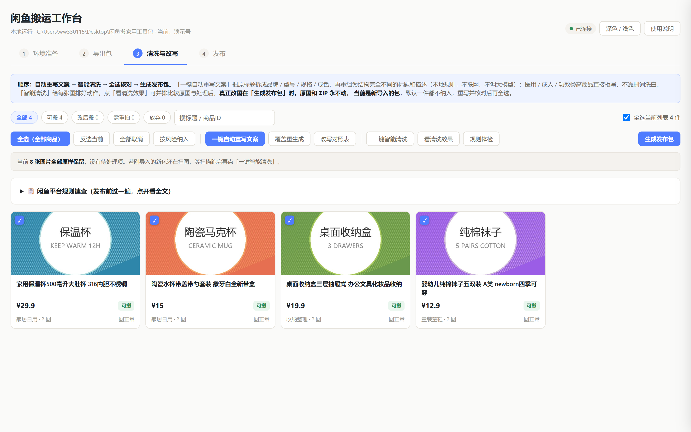
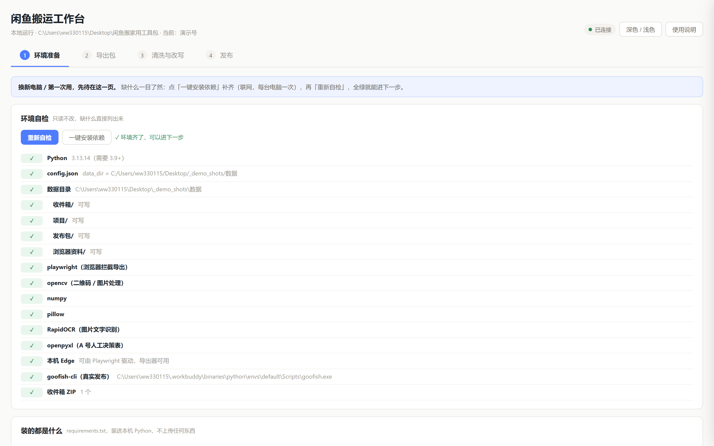
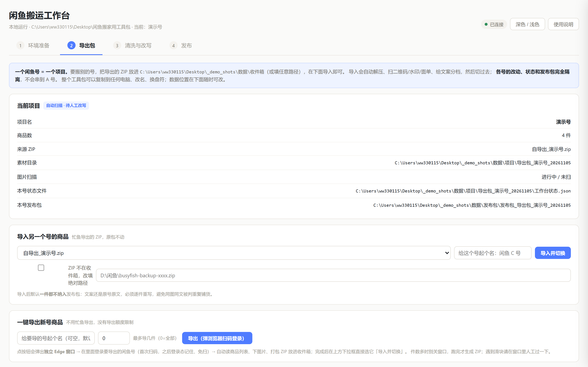
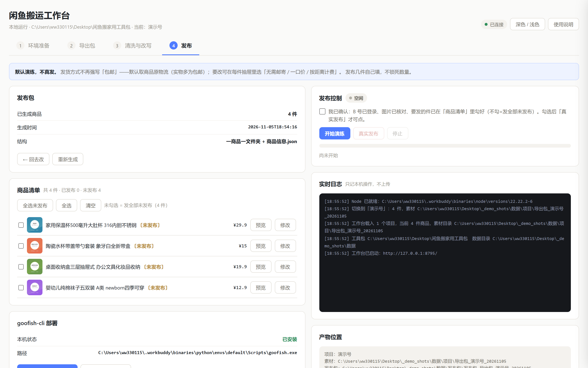

**English** | [简体中文](README.zh-CN.md)


# Goofish Mover

A fully local Windows workbench that moves all on-sale listings from one Goofish
(Xianyu) account to another: **export → clean & rewrite → rule check → publish**.

- **Local-only.** One Python file server on `127.0.0.1`; no cloud, no telemetry, your
  data never leaves the PC.
- **Offline rewrite engine.** Restructures titles/descriptions locally (no LLM calls),
  scrubs QR codes / barcodes / shipping labels / watermarks from photos.
- **Rule check built in.** Scans every listing for 9 classes of platform risk before
  you publish — off-site contact, counterfeit words, superlatives, duplicates…
- **Safe publishing.** Dry-run by default; real publishing via goofish-cli at
  1 item/minute with read-back verification and duplicate protection.
- **Docs for humans and agents:** this README for you, [`AGENT_GUIDE.md`](AGENT_GUIDE.md)
  for your AI assistant.



> Every listing, image and price in these screenshots is **generated demo data**
> (fake products drawn with PIL). Nothing here is the author's real account.

## What it does

| Step | Page | What happens |
|---|---|---|
| ① | Environment | Self-checks Python / dependencies / Edge / goofish-cli; one-click install for anything missing |
| ② | Export | QR-login in a dedicated Edge window, fetches your own on-sale listings, packs a ZIP; session persists |
| ③ | Clean & Rewrite | Offline rewrite, image scrubbing, platform-rule check, per-item review → build publish package |
| ④ | Publish | Dry-run first; real publish with rate limit, auto-skip on failure, published markers |

## Screenshots

| Environment | Export |
|---|---|
|  |  |

| Clean & Rewrite | Publish |
|---|---|
|  |  |

## Quick start (Windows)

### Option 1: double-click

1. Double-click **`启动工作台.cmd`** (the launcher). It finds a Python 3.9+ for you —
   and if none exists, offers to auto-download a portable Python (~12 MB).
2. On page ① click **Install dependencies** once (internet needed, once per machine).
3. Follow the four pages: export your source account → clean & rewrite → publish.

### Option 2: run from source

```bat
git clone https://github.com/ww330115/goofish-mover.git
cd goofish-mover
python -m pip install -r app\requirements.txt
python app\workbench.py
```

The UI opens at `http://127.0.0.1:8765`. No `playwright install` needed — the tool
drives the system Edge browser via channel.

### Option 3: let an AI set it up

Hand [`AGENT_GUIDE.md`](AGENT_GUIDE.md) (CN/EN) to any AI assistant — it contains the
full deployment steps, API map, data layout and the hard rules the agent must follow
(never exfiltrate `数据\`, never publish without your confirmation).

## Where your data lives

Everything is created and kept inside the toolkit folder (path configurable in
`config.json`):

```
数据\
  收件箱\      exported ZIPs land here
  项目\        one folder per account (listings, images, states)
  发布包\      one folder per listing + publish script + published records
  浏览器资料\  Edge profile holding the login session — never share it
```

Original images and ZIPs are never modified; all results go to new folders.

## Privacy & risk control

- No telemetry, no cloud calls; the only network traffic is Goofish itself,
  pip installs, and the Goofish publish API when you enable real publishing.
- The exporter reads two endpoints of **your own** account only — it never searches
  other people's listings, fakes devices, or bypasses captchas (it stops at sliders).
- Publishing defaults to dry-run; real mode is rate-limited to 1 item/minute and
  verifies each listing after posting.

## Disclaimer

This tool manages **your own account's** listings. Xianyu/Goofish prohibits
unauthorized automation; using it may violate the platform terms and can lead to
delisting or suspension — **at your own risk**. Comply with local laws.

## License

Free for personal use. Reselling, bundling for sale, or republishing under another
name is not allowed — see [LICENSE](LICENSE). If you find it useful, a ⭐ Star is
the best support.
