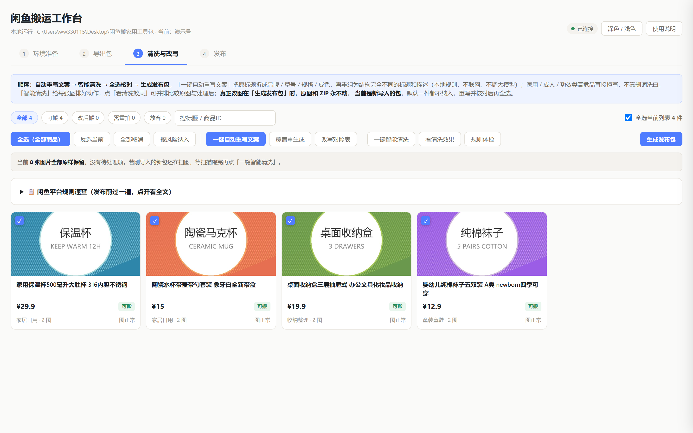
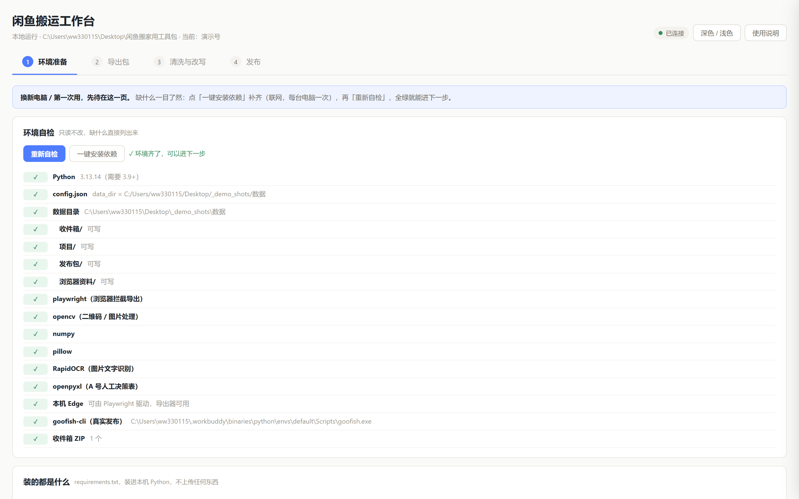
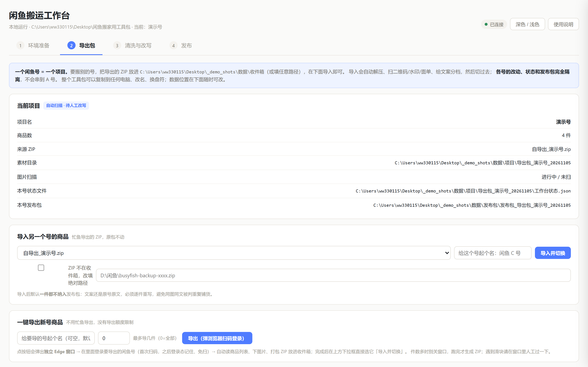
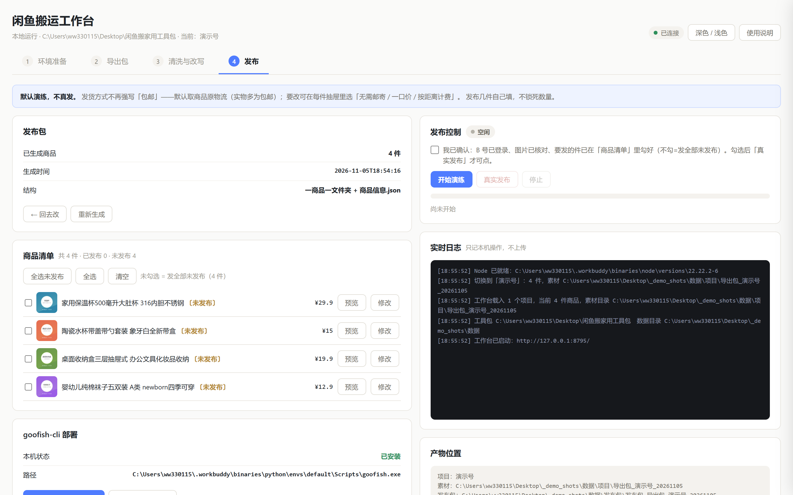

[English](README.md) | **简体中文**


# Goofish Mover · 闲鱼搬家用工具包

**纯本地**运行的 Windows 闲鱼商品搬家工作台：把一个账号的在售商品整体搬到另一个账号，
**导出 → 清洗改写 → 规则体检 → 限速发布**，数据全程不出这台电脑。

- **本地运行**：单文件 Python 服务只监听 `127.0.0.1`，无云端依赖、无遥测
- **离线改写**：本地规则引擎重组标题/描述（不联网、不调大模型）；图片自动抹二维码/
  条形码、删快递面单、裁平台水印
- **平台规则体检**：发布前逐件扫 9 类风险——站外引流、售假词、绝对化用语、重复铺货…
- **安全发布**：默认演练；真实发布走 goofish-cli，1 件/分钟限速、发布后回读核对、
  已发布标记防重复
- **给人也 给 AI 的文档**：本 README 给你，[`AGENT_GUIDE.md`](AGENT_GUIDE.md) 给你的
  AI 助手（中英双语，读完即可代你部署）



> 截图里的所有商品、图片、价格均为 **PIL 生成的演示假数据**，不是作者的真实账号。

## 四步流程

| 步骤 | 页面 | 做什么 |
|---|---|---|
| ① | 环境准备 | 自检 Python / 依赖 / Edge / goofish-cli，缺什么一键补齐，新机免敲命令 |
| ② | 导出包 | 弹独立 Edge 窗口扫码登录，自动抓自己账号的在售商品打包 ZIP，登录态留存免扫码 |
| ③ | 清洗与改写 | 离线改写 + 图片清洗 + 规则体检，逐件核对后生成发布包 |
| ④ | 发布 | 默认演练；真实发布带限速、失败自动跳过、已发布标记 |

## 截图

| 环境准备 | 导出包 |
|---|---|
|  |  |

| 清洗与改写 | 发布 |
|---|---|
|  |  |

## 快速开始（Windows）

### 方式一：双击即用

1. 双击 **`启动工作台.cmd`**。启动器自动找 Python 3.9+；找不到会询问是否
   **自动下载便携版 Python（约 12 MB）**。
2. 第 ① 页点一次 **一键安装依赖**（联网，每台电脑一次），全绿进入下一步。
3. 按四页走：导出源账号 → 清洗改写 → 发布。

### 方式二：源码运行

```bat
git clone https://github.com/ww330115/goofish-mover.git
cd goofish-mover
python -m pip install -r app\requirements.txt
python app\workbench.py
```

浏览器自动打开 `http://127.0.0.1:8765`。**不需要** `playwright install`——
浏览器自动化直接驱动系统自带 Edge。

### 方式三：让 AI 替你部署

把 [`AGENT_GUIDE.md`](AGENT_GUIDE.md) 交给任何 AI 助手（Claude / ChatGPT / WorkBuddy…），
里面有完整部署步骤、API 速查、目录结构，以及 Agent 必须遵守的红线
（登录态不外传、发布必须经你确认等）。

## 数据在哪

所有数据都在工具包目录内（路径可在 `config.json` 改）：

```
数据\
  收件箱\      导出的 ZIP
  项目\        一个账号一个文件夹（商品、图片、状态）
  发布包\      一商品一文件夹 + 发布脚本 + 发布记录
  浏览器资料\  Edge 登录态——不要外传这个文件夹
```

原图和原始 ZIP 永不修改，所有处理结果写入新目录。

## 隐私与风控

- 无遥测、无云端调用；联网只有三处：闲鱼本身、pip 装依赖、开启真实发布后的闲鱼发布接口
- 导出器只读**你自己账号**的两个接口，不搜他人商品、不伪造设备、不绕滑块（遇滑块停下）
- 发布默认演练；真实模式限速 1 件/分钟，发布后逐件回读核对

## 免责声明

本工具仅供管理**自己账号**的商品。闲鱼平台禁止未经授权的自动化操作，使用本工具可能
违反平台用户协议，存在下架、限流、封号风险，**后果自负**。请遵守所在法律法规。

## 授权

个人可免费下载、使用、修改，供自己搬家使用；**禁止转售、打包售卖、冒名发布**，
详见 [LICENSE](LICENSE)。觉得好用的话，给个 ⭐ Star 就是最好的支持。
